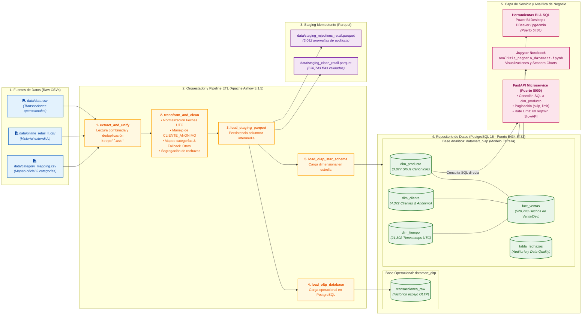

# Proyecto de Ingenieria de Datos: Caso DataMart S.A.S.

Solucion de arquitectura y procesamiento de datos para **DataMart S.A.S.** que ingesta transacciones heterogeneas, depura inconsistencias de catalogo, preserva clientes anonimos y devoluciones, y construye un Data Warehouse dimensional en **PostgreSQL**, orquestado mediante **Apache Airflow 3.1.5** y listo para consumo analitico en **Power BI Desktop**, **Jupyter Notebook** y microservicios **FastAPI**.

---

## 1. Arquitectura de la Solucion



---

## 2. Estructura del Repositorio

```text
.
├── .env.example                    # Plantilla de variables de entorno
├── .env                            # Variables locales de ejecucion
├── .gitignore                      # Reglas de exclusion en git
├── docker-compose.yaml             # Definicion de servicios: postgres, airflow, api
├── README.md                       # Documentacion tecnica y operativa
├── DECISIONES.md                   # Registro de decisiones de arquitectura (ADR)
├── analisis_negocio_datamart.ipynb # Notebook ejecutable con las 7 consultas y graficos
├── api/                            # Microservicio REST de catalogo (FastAPI)
│   ├── Dockerfile                  # Imagen python:3.10-slim con dependencias
│   └── main.py                     # Endpoints con paginacion SQL y SlowAPI rate limiting
├── entregables/                    # Evidencias y capturas de sustentacion
│   ├── README.md                   # Checklist de entregables requeridos
│   ├── MODELO_Y_CONSULTAS.md       # Codigo DBML, Mermaid y SQL oficial
│   └── .gitkeep
├── data/                           # Fuentes de datos oficiales
│   ├── data.csv                    # Transacciones diarias operacionales
│   ├── online_retail_II.csv        # Historial transaccional extendido
│   └── category_mapping.csv        # Mapeo de categorias oficiales
├── sql/                            # Scripts DDL y consultas
│   ├── 01_init_databases.sql       # Creacion de bases de datos y roles
│   ├── 02_init_oltp.sql            # DDL tabla transacciones_raw
│   ├── 03_init_olap.sql            # DDL modelo estrella y tabla_rechazos
│   ├── modelo_dimensional.dbml     # Modelo para dbdiagram.io
│   └── queries_negocio.sql         # Consultas analiticas de la seccion 7
└── dags/                           # Pipeline en Apache Airflow 3
    ├── __init__.py
    ├── etl_retail_dag.py           # DAG principal con TaskFlow y TaskGroups
    └── modules/
        ├── __init__.py
        ├── config.py               # Rutas, constantes y parametros de conexion
        ├── transform.py            # Deduplicacion, homologacion y rechazos
        └── olap.py                 # Persistencia dimensional idempotente
```

---

## 3. Guia de Puesta en Marcha (Paso a Paso)

### 3.1. Requisitos Previos
* Git instalado.
* Docker Desktop 4.x o superior en ejecucion con soporte para Linux containers.
* Al menos 4 GB de memoria RAM libre para los contenedores.

### 3.2. Clonacion y Configuracion de Entorno
```bash
git clone <URL_DEL_REPOSITORIO>
cd fff

# Copiar plantilla de variables
cp .env.example .env
```

### 3.3. Inicializacion y Despliegue con Docker Compose
```bash
# Levantar servicios en segundo plano
docker compose up -d
```

Este comando inicia:
1. `postgres`: Base de datos PostgreSQL 15 expuesta en el puerto local **5434** (para evitar colisiones con instancias locales).
2. `airflow-init`: Ejecuta migraciones, crea el usuario administrativo y prepara los metadatos.
3. `airflow-standalone`: Motor de Airflow 3.1.5 que arranca Webserver, Scheduler y Triggerer en el puerto **8080**.
4. `products-api`: Microservicio FastAPI en el puerto **8000** conectado al catalogo `datamart_olap`.

Verificar estado:
```bash
docker compose ps
```

---

## 4. Ejecucion del Pipeline ETL en Airflow

1. Abrir la interfaz web de Airflow: [http://localhost:8080](http://localhost:8080).
2. Credenciales por defecto: **Usuario:** `admin` | **Contrasena:** `admin`.
3. Localizar el DAG `etl_retail_dag`.
4. Activar el toggle (unpause) y hacer clic en **Trigger DAG** (boton de play).
5. Secuencia de tareas ejecutadas:
   * `validate_inputs`: Confirma la presencia de `data.csv`, `online_retail_II.csv` y `category_mapping.csv`.
   * `extract_transform_validate`: Deduplica transacciones (dando prioridad a `online_retail_II.csv`), estandariza descripciones por moda estadistica, asigna categorias, identifica clientes anonimos y separa precios negativos en la tabla de rechazos.
   * `load_staging_parquet`: Persiste data validada e incidencias en formato Parquet en `./data/`.
   * `capa_operacional_oltp.load_to_oltp`: Inserta 528,743 registros en `datamart_oltp.transacciones_raw`.
   * `capa_analitica_olap.load_to_olap`: Carga idempotente en `datamart_olap` (`dim_cliente`, `dim_producto`, `dim_tiempo`, `fact_ventas`, `tabla_rechazos`).
   * `audit_and_quality_check`: Realiza cuadre financiero exacto entre el revenue transformado y la tabla de hechos en PostgreSQL.

---

## 5. Visualizacion y Analitica de Negocio

### 5.1. Cuadro de Mando en Jupyter Notebook
Abrir el archivo [analisis_negocio_datamart.ipynb](file:///c:/Users/Coder/Desktop/fff/analisis_negocio_datamart.ipynb). El notebook ya se encuentra pre-renderizado con los graficos y tablas de resultados, listo para revision ejecutiva o re-ejecucion directa:
* Diseno visual sobrio en escala corporativa (azul marino y carmesi para devoluciones).
* Conectado a `datamart_olap` y `datamart_oltp` en el puerto `5434`.

### 5.2. Conexion a Power BI Desktop
1. Abrir Power BI Desktop -> **Obtener datos** -> **Base de datos PostgreSQL**.
2. Parametros de conexion:
   * **Servidor:** `localhost:5434`
   * **Base de datos:** `datamart_olap`
   * **Modo de conectividad:** Importar o DirectQuery
3. Credenciales de acceso:
   * **Usuario:** `airflow` (o `postgres`)
   * **Contrasena:** `airflow` (o `postgres`)
4. Seleccionar tablas: `fact_ventas`, `dim_producto`, `dim_cliente`, `dim_tiempo`.

### 5.3. Microservicio de Productos (FastAPI)
* Documentacion Swagger interactiva: [http://localhost:8000/docs](http://localhost:8000/docs).
* Consulta paginada: `GET http://localhost:8000/products?skip=0&limit=50&category=Ropa`
* Control de tasa: Configurado a 60 llamadas por minuto por direccion IP.

---

## 6. Respuestas a las Preguntas Oficiales de Negocio

Metricas calculadas sobre los **528,743 registros** de la tabla de hechos `fact_ventas`:

### 1. Evolucion Mensual de Ventas Netas (Descontando Devoluciones)
* **Inicio (Dic 2010):** GBP 741,607.72 netos (1,885 ordenes).
* **Valle del Periodo:** Febrero (GBP 491,732.14) y Abril 2011 (GBP 496,207.77).
* **Fase de Expansion:** Crecimiento sostenido desde Agosto (GBP 650k) hasta Octubre (GBP 1.07M).
* **Pico del Negocio:** Noviembre 2011 alcanzo **GBP 1,447,211.53 netos** (3,210 ordenes unicas y 713,222 unidades netas vendidas).

### 2. Categorias: Revenue Bruto vs Proporcion de Devoluciones
| Categoria | Revenue Bruto (GBP) | Devoluciones (GBP) | Revenue Neto (GBP) | % Tasa Devolucion |
| :--- | :--- | :--- | :--- | :--- |
| **Ropa** | 1,160,317.10 | 20,079.55 | 1,140,237.55 | **1.86%** *(Bajo)* |
| **Hogar** | 870,727.14 | 23,952.99 | 846,774.15 | **3.00%** *(Saludable)* |
| **Papeleria** | 831,804.69 | **179,746.12** | 652,058.57 | **13.47%** *(Critico)* |
| **Electronica** | 675,338.28 | 22,399.68 | 652,938.60 | **5.62%** *(Moderado)* |
| **Deportes** | 109,886.89 | 1,965.73 | 107,921.16 | **0.78%** *(Minimo)* |
| **Otros** | 6,944,337.56 | 633,521.08 | 6,310,816.48 | **4.09%** *(General)* |

* **Mayor revenue bruto:** *Ropa* lidera las categorias clasificadas con GBP 1.16M brutos.
* **Mayor tasa de devolucion:** *Papeleria* presenta una tasa del **13.47%** (GBP 179.7k devueltos), mientras que *Deportes* registra la menor friccion (0.78%).

### 3. Top 10 Productos con Mayor Revenue Neto vs Top 10 Mayor Tasa de Devolucion
* **Top 5 Revenue Neto:**
  1. `DOT` (DOTCOM POSTAGE): GBP 206,245.48
  2. `22423` (REGENCY CAKESTAND 3 TIER): GBP 163,837.28
  3. `85123A` (WHITE HANGING HEART T-LIGHT HOLDER): GBP 99,331.06
  4. `47566` (PARTY BUNTING): GBP 98,040.85
  5. `85099B` (JUMBO BAG RED RETROSPOT): GBP 92,028.92
* **Top 5 Devoluciones Criticas (Muestras >= 100 unidades):**
  1. `23843` (PAPER CRAFT, LITTLE BIRDIE): **100.0% devolucion** (80,995 un. devueltas, perdida de GBP 168,469.60).
  2. `84347` (ROTATING SILVER ANGELS T-LIGHT HLDR): **99.8% devolucion** (9,360 un. devueltas).
  3. `23166` (MEDIUM CERAMIC TOP STORAGE JAR): **95.5% devolucion** (74,215 un. devueltas, perdida de GBP 77,479.40).
  4. `85232B` (SET OF 3 BABUSHKA NESTING TINS): **93.1% devolucion**.
  5. `23113` (PANTRY CHOPPING BOARD): **82.0% devolucion**.

### 4. Concentracion Geografica y Ticket Promedio
* **Concentracion:** Reino Unido concentra el **84.2% de la facturacion total** (GBP 8,181,768.12 en 21,464 ordenes) con un ticket promedio de **GBP 381.15**.
* **Perfil Mayorista Internacional:**
  * **Paises Bajos (Netherlands):** Ticket promedio de **GBP 2,846.62** (7.5x el promedio de UK).
  * **Australia:** Ticket promedio de **GBP 2,330.18**.
  * **Japon:** Ticket promedio de **GBP 1,344.62**.
  * **Irlanda (EIRE):** Ticket promedio de **GBP 783.65**.

### 5. Clientes Identificados vs Anonimos (`CLIENTE_ANONIMO`)
* **Clientes Registrados:** 22,186 ordenes | GBP 8,248,003.41 (84.94% de las ventas) | Ticket promedio: **GBP 371.77**.
* **Clientes Anonimos:** 1,610 ordenes | **GBP 1,462,743.10 (15.06% de las ventas)** | Ticket promedio: **GBP 908.54**.
* **Hallazgo:** Los clientes anonimos compran con un ticket **2.44 veces mayor**. Descartarlos habria eliminado el 15% del revenue de la empresa.

### 6. Calidad de Catalogo y SKUs Unicos
* **Codigos unicos de producto en catalogo:** **3,827 SKUs**.
* **SKUs con descripciones inconsistentes:** **207 productos (5.41%)** registraban multiples variantes de texto en la tabla operacional `transacciones_raw`. Fueron unificados en `dim_producto` usando la moda estadistica.

### 7. Recomendacion Concreta al Equipo de Producto
1. **Retiro de SKUs Problematicos:** Pausar la venta de `23843` y `23166`. Entre ambos suman **GBP 245,949.00 en devoluciones** con tasas superiores al 95%.
2. **Auditoria de Empaque en Papeleria:** La categoria registra un **13.47% de devoluciones** (GBP 179.7k). Se recomienda revisar materiales de proteccion y embalaje contra humedad.
3. **Canal Mayorista B2B en Paises Bajos y Australia:** Por sus tickets promedio de GBP 2,846 y GBP 2,330, habilitar condiciones comerciales de compra en volumen con tarifas preferenciales de envio.
4. **Captura Poscompra de Clientes Anonimos:** Con GBP 1.46M en compras y ticket de GBP 908.54, ofrecer registro rapido con beneficios corporativos para formalizar su perfil.
