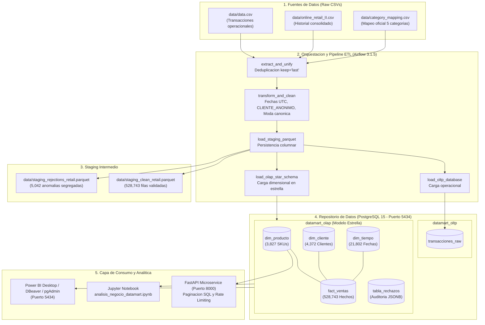
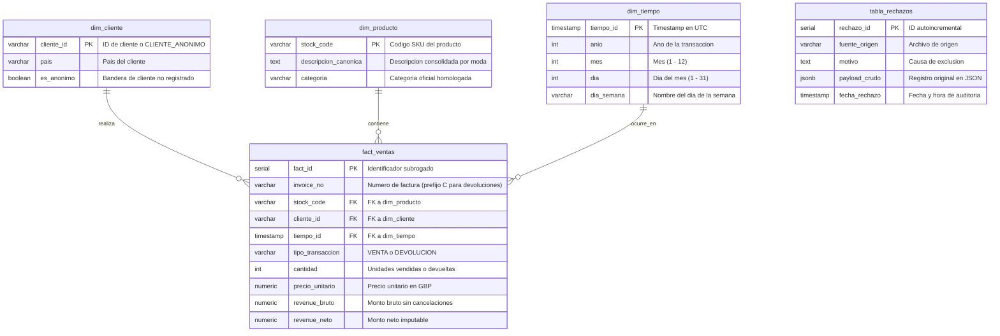

# Entregables: Arquitectura, Diagrama del Modelo y Consultas SQL Oficiales
## DataMart S.A.S. - Ingenieria de Datos

Este documento reune los insumos tecnicos para la sustentacion y generacion de evidencias del repositorio analitico:

---

## 1. Arquitectura General del Proyecto



---

## 2. Diagrama del Modelo Dimensional (`datamart_olap`)

### A. Diagrama Mermaid (ERD)


### B. Codigo DBML para dbdiagram.io
Copiar y pegar en [https://dbdiagram.io](https://dbdiagram.io):

```dbml
Table dim_cliente {
  cliente_id varchar(50) [pk, note: "ID unico o CLIENTE_ANONIMO"]
  pais varchar(100) [note: "Pais del cliente"]
  es_anonimo boolean [default: false, note: "Flag de cliente anonimo"]
}

Table dim_producto {
  stock_code varchar(50) [pk, note: "SKU unico de producto"]
  descripcion_canonica text [note: "Descripcion mas frecuente"]
  categoria varchar(50) [note: "Categoria oficial asignada"]
}

Table dim_tiempo {
  tiempo_id timestamp [pk, note: "Timestamp en UTC"]
  anio int [note: "Ano"]
  mes int [note: "Mes"]
  dia int [note: "Dia"]
  dia_semana varchar(20) [note: "Dia de la semana"]
}

Table fact_ventas {
  fact_id serial [pk, note: "ID subrogado"]
  invoice_no varchar(50) [note: "Factura (prefijo C para devolucion)"]
  stock_code varchar(50) [ref: > dim_producto.stock_code, note: "FK a dim_producto"]
  cliente_id varchar(50) [ref: > dim_cliente.cliente_id, note: "FK a dim_cliente"]
  tiempo_id timestamp [ref: > dim_tiempo.tiempo_id, note: "FK a dim_tiempo"]
  tipo_transaccion varchar(20) [note: "VENTA o DEVOLUCION"]
  cantidad int [note: "Unidades"]
  precio_unitario numeric(10, 2) [note: "Precio unitario"]
  revenue_bruto numeric(12, 2) [note: "Revenue bruto"]
  revenue_neto numeric(12, 2) [note: "Revenue neto"]
}

Table tabla_rechazos {
  rechazo_id serial [pk, note: "ID del rechazo"]
  fuente_origen varchar(100) [note: "Archivo de origen"]
  motivo text [note: "Causa de rechazo"]
  payload_crudo jsonb [note: "Payload original"]
  fecha_rechazo timestamp [note: "Fecha de rechazo"]
}
```

---

## 3. Consultas SQL de Validacion Oficiales (Seccion 7)

Conexion recomendada: `datamart_olap` en `localhost:5434` (usuario `airflow` o `postgres`).

### Consulta 1: Evolucion mensual de ventas netas
```sql
SELECT 
    t.anio,
    t.mes,
    TO_CHAR(t.tiempo_id, 'TMMonth YYYY') AS periodo,
    COUNT(CASE WHEN f.tipo_transaccion = 'VENTA' THEN 1 END) AS transacciones_venta,
    COUNT(CASE WHEN f.tipo_transaccion = 'DEVOLUCION' THEN 1 END) AS transacciones_devolucion,
    ROUND(SUM(CASE WHEN f.tipo_transaccion = 'VENTA' THEN f.revenue_bruto ELSE 0 END), 2) AS revenue_ventas,
    ROUND(SUM(CASE WHEN f.tipo_transaccion = 'DEVOLUCION' THEN ABS(f.revenue_bruto) ELSE 0 END), 2) AS revenue_devoluciones,
    ROUND(SUM(f.revenue_neto), 2) AS revenue_neto
FROM fact_ventas f
JOIN dim_tiempo t ON f.tiempo_id = t.tiempo_id
GROUP BY t.anio, t.mes, TO_CHAR(t.tiempo_id, 'TMMonth YYYY')
ORDER BY t.anio, t.mes;
```

### Consulta 2: Revenue bruto y devoluciones por categoria
```sql
SELECT 
    p.categoria,
    ROUND(SUM(CASE WHEN f.tipo_transaccion = 'VENTA' THEN f.revenue_bruto ELSE 0 END), 2) AS revenue_ventas_bruto,
    ROUND(SUM(CASE WHEN f.tipo_transaccion = 'DEVOLUCION' THEN ABS(f.revenue_bruto) ELSE 0 END), 2) AS revenue_devoluciones,
    ROUND(SUM(f.revenue_neto), 2) AS revenue_neto,
    ROUND(
        (SUM(CASE WHEN f.tipo_transaccion = 'DEVOLUCION' THEN ABS(f.revenue_bruto) ELSE 0 END)::NUMERIC / 
        NULLIF(SUM(CASE WHEN f.tipo_transaccion = 'VENTA' THEN f.revenue_bruto ELSE 0 END), 0)::NUMERIC) * 100, 
        2
    ) AS pct_tasa_devolucion_monetaria
FROM fact_ventas f
JOIN dim_producto p ON f.stock_code = p.stock_code
GROUP BY p.categoria
ORDER BY revenue_neto DESC;
```

### Consulta 3A: Top 10 productos con mayor revenue neto
```sql
SELECT 
    f.stock_code,
    p.descripcion_canonica,
    p.categoria,
    SUM(f.cantidad) AS unidades_netas,
    ROUND(SUM(f.revenue_neto), 2) AS total_revenue_neto
FROM fact_ventas f
JOIN dim_producto p ON f.stock_code = p.stock_code
GROUP BY f.stock_code, p.descripcion_canonica, p.categoria
HAVING SUM(f.revenue_neto) > 0
ORDER BY total_revenue_neto DESC
LIMIT 10;
```

### Consulta 3B: Top 10 productos con mayor tasa de devolucion (Min. 50 unidades vendidas)
```sql
SELECT 
    f.stock_code,
    p.descripcion_canonica,
    p.categoria,
    SUM(CASE WHEN f.tipo_transaccion = 'VENTA' THEN f.cantidad ELSE 0 END) AS unidades_vendidas,
    SUM(CASE WHEN f.tipo_transaccion = 'DEVOLUCION' THEN ABS(f.cantidad) ELSE 0 END) AS unidades_devueltas,
    ROUND(
        (SUM(CASE WHEN f.tipo_transaccion = 'DEVOLUCION' THEN ABS(f.cantidad) ELSE 0 END)::NUMERIC / 
        NULLIF(SUM(CASE WHEN f.tipo_transaccion = 'VENTA' THEN f.cantidad ELSE 0 END), 0)::NUMERIC) * 100, 
        2
    ) AS pct_tasa_devolucion_unidades,
    ROUND(SUM(CASE WHEN f.tipo_transaccion = 'DEVOLUCION' THEN ABS(f.revenue_bruto) ELSE 0 END), 2) AS impacto_monetario_perdido
FROM fact_ventas f
JOIN dim_producto p ON f.stock_code = p.stock_code
GROUP BY f.stock_code, p.descripcion_canonica, p.categoria
HAVING SUM(CASE WHEN f.tipo_transaccion = 'VENTA' THEN f.cantidad ELSE 0 END) >= 50
ORDER BY pct_tasa_devolucion_unidades DESC
LIMIT 10;
```

### Consulta 4: Paises con mayor volumen y variacion de ticket promedio
```sql
SELECT 
    c.pais,
    COUNT(DISTINCT f.invoice_no) AS total_ordenes,
    COUNT(DISTINCT f.cliente_id) AS total_clientes_unicos,
    ROUND(SUM(f.revenue_neto), 2) AS revenue_neto_total,
    ROUND(SUM(f.revenue_neto) / NULLIF(COUNT(DISTINCT f.invoice_no), 0), 2) AS ticket_promedio_por_orden
FROM fact_ventas f
JOIN dim_cliente c ON f.cliente_id = c.cliente_id
WHERE f.tipo_transaccion = 'VENTA'
GROUP BY c.pais
ORDER BY revenue_neto_total DESC;
```

### Consulta 5: Comportamiento: Clientes identificados vs anonimos
```sql
SELECT 
    CASE WHEN c.es_anonimo THEN 'Clientes Anonimos' ELSE 'Clientes Identificados' END AS segmento_cliente,
    COUNT(DISTINCT f.invoice_no) AS total_pedidos,
    COUNT(DISTINCT f.cliente_id) AS clientes_unicos,
    SUM(f.cantidad) AS volumen_unidades,
    ROUND(SUM(f.revenue_neto), 2) AS revenue_neto_total,
    ROUND(
        (SUM(f.revenue_neto) / (SELECT SUM(revenue_neto) FROM fact_ventas)) * 100, 
        2
    ) AS pct_participacion_facturacion,
    ROUND(SUM(f.revenue_neto) / NULLIF(COUNT(DISTINCT f.invoice_no), 0), 2) AS ticket_promedio
FROM fact_ventas f
JOIN dim_cliente c ON f.cliente_id = c.cliente_id
GROUP BY c.es_anonimo;
```

### Consulta 6: Total de codigos unicos y auditoria de catalogo
```sql
-- Ejecutable directamente en datamart_olap
SELECT 
    COUNT(DISTINCT stock_code) AS total_skus_unicos_catalogo,
    COUNT(CASE WHEN categoria = 'Otros' THEN 1 END) AS skus_sin_mapeo_categoria,
    COUNT(CASE WHEN categoria != 'Otros' THEN 1 END) AS skus_con_categoria_oficial
FROM dim_producto;

-- Auditoria en datamart_oltp (ejecutar en base datamart_oltp):
-- SELECT COUNT(DISTINCT stock_code) FROM transacciones_raw;
-- SELECT stock_code, COUNT(DISTINCT description) FROM transacciones_raw GROUP BY stock_code HAVING COUNT(DISTINCT description) > 1;
```

### Consulta 7: Respaldo numerico para recomendacion al equipo de producto
```sql
SELECT 
    p.categoria,
    p.stock_code,
    p.descripcion_canonica,
    SUM(CASE WHEN f.tipo_transaccion = 'VENTA' THEN f.cantidad ELSE 0 END) AS ventas_unidades,
    SUM(CASE WHEN f.tipo_transaccion = 'DEVOLUCION' THEN ABS(f.cantidad) ELSE 0 END) AS devoluciones_unidades,
    ROUND(
        (SUM(CASE WHEN f.tipo_transaccion = 'DEVOLUCION' THEN ABS(f.cantidad) ELSE 0 END)::NUMERIC / 
        NULLIF(SUM(CASE WHEN f.tipo_transaccion = 'VENTA' THEN f.cantidad ELSE 0 END), 0)::NUMERIC) * 100,
        2
    ) AS tasa_devolucion_pct,
    ROUND(SUM(CASE WHEN f.tipo_transaccion = 'DEVOLUCION' THEN ABS(f.revenue_bruto) ELSE 0 END), 2) AS costo_financiero_devolucion
FROM fact_ventas f
JOIN dim_producto p ON f.stock_code = p.stock_code
GROUP BY p.categoria, p.stock_code, p.descripcion_canonica
HAVING SUM(CASE WHEN f.tipo_transaccion = 'VENTA' THEN f.cantidad ELSE 0 END) >= 100
   AND (SUM(CASE WHEN f.tipo_transaccion = 'DEVOLUCION' THEN ABS(f.cantidad) ELSE 0 END)::NUMERIC / 
        NULLIF(SUM(CASE WHEN f.tipo_transaccion = 'VENTA' THEN f.cantidad ELSE 0 END), 0)::NUMERIC) >= 0.50
ORDER BY costo_financiero_devolucion DESC
LIMIT 10;
```
